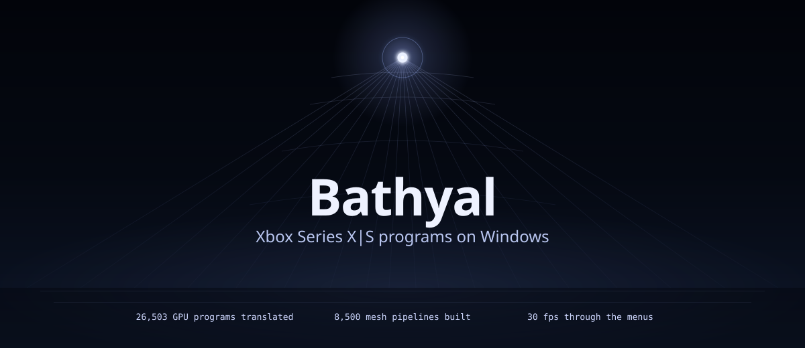

# Bathyal

Bathyal runs an Xbox Series X|S title natively on a Windows x86-64 PC.

This repository currently hosts high-level project information and progress updates only. More details will be shared in the future.

**Legal disclaimer:** Bathyal is an independent cleanroom compatibility and research project. It includes no copyrighted game files, no decryption keys, and no DRM bypasses. It is not affiliated with or endorsed by Microsoft or Xbox.

## Status

- The title boots and the menus run at 30 fps.
- Audio decodes with no errors.
- The console GPU programs are translated, and the world's mesh pipelines are built.
- The world itself is still being brought up.
- 26,503 GPU programs translated. 8,500 mesh pipelines built. 30 fps through the menus.

## How it works

The console CPU is x86-64, so the title's own machine code runs directly on the PC. Four parts make that work:

1. **PE loader.** Maps the title executable, applies its relocations, resolves its imports, and sets up its TLS callbacks and exception tables.
2. **Import layer.** Resolves the title's calls to the console system libraries (`kernelx.dll`, XGameRuntime, `d3d12_xs.dll` and others) to our own implementation, in the spirit of Wine and Proton.
3. **D3D12 bridge.** Backs the console D3D12 API with the PC's D3D12: device, resources, heaps, pipelines, command lists and presentation.
4. **GPU program translation.** Translates the console's precompiled RDNA2 GPU programs to DXIL.

All content is read from a local copy of the game package. The game folder is never modified: writes go to an overlay.

## Legal and licence

Bathyal is released under **GPL-2.0-only**; the full licence text is in [`LICENSE`](LICENSE).

Copyright (C) 2026 T-Crypt.

Bathyal is a fork of [ivall/xcl](https://github.com/ivall/xcl) by ivall and its contributors, under the same GPL-2.0 licence. The full upstream history is kept in this repository, and each commit names its author. Changes from upstream are merged on a branch and credited in that history. The upstream credit is in [`NOTICE.md`](NOTICE.md), and outside sources with their licences are in [`THIRD_PARTY.md`](THIRD_PARTY.md).

The repository holds source code, tests and documentation only: no game files, shaders, assets, keys or logs from a game, and nothing for decryption or DRM. Bring your own legally obtained, unpacked files.

## Building

Windows 10/11 x64, Rust (`stable-x86_64-pc-windows-msvc`), the Windows SDK with DXC (`dxcompiler.dll` and `dxil.dll`), a D3D12 GPU with Shader Model 6.6 and mesh shaders, and the system XGameRuntime.

This project is developed and tested on **Intel and NVIDIA hardware**: an Intel Core i9-14900K with UHD Graphics 770, and an NVIDIA GeForce RTX 4090. AMD GPUs are not tested here. That matters for shader fidelity: the console GPU is AMD RDNA2 and its programs are wave64, so on 32-wide hardware, cross-half wave operations are approximate.

```powershell
cargo build --release --workspace          # target\release\bathyal.exe
.\scripts\test.ps1                         # cargo build + cargo test --workspace
```

The program builds as `bathyal.exe`. The crate, the `XCL_*` settings and the `%LOCALAPPDATA%\XCL` data folder keep XCL's names so upstream merges stay clean.

Measurements and open work are in [`HANDOFF.md`](HANDOFF.md).
